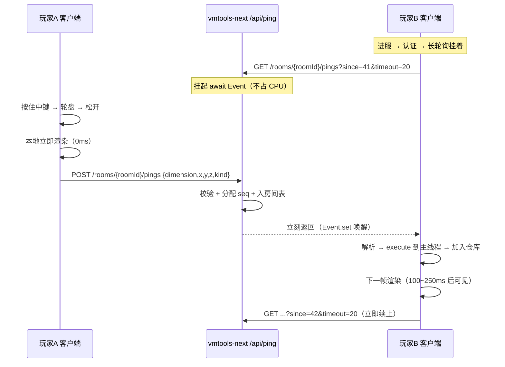
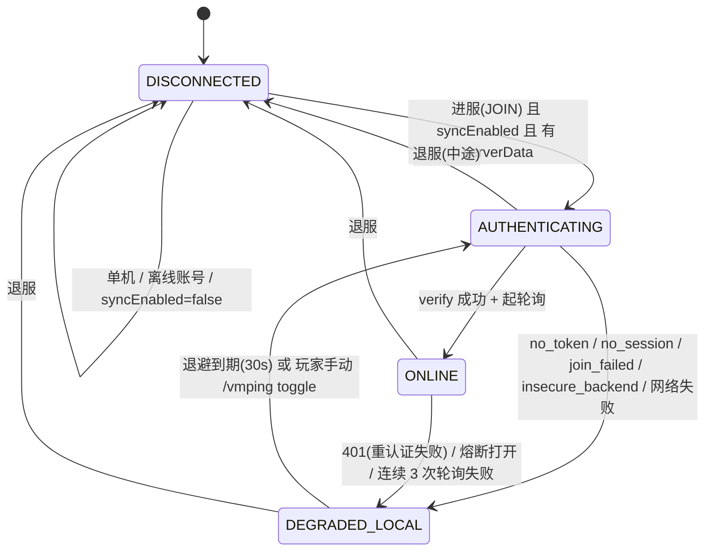

# VMPing 实现方案

> 版本：v1（2026-11-02）｜作者：ping-research（调研员）
> 配套文档：[`可行性调研.md`](./可行性调研.md)（证据与结论）、[`上游参考.md`](./上游参考.md)（借鉴与许可）
> 接口契约：[`协议-v1.md`](./协议-v1.md)（本文 §12 提出 8 条修改建议）

---

## 1. 目标与非目标

### 1.1 目标（v1.0.0）

| 编号 | 目标 | 验收口径 |
|---|---|---|
| G1 | **服务器零安装**：只装客户端 mod 就能让同服玩家看见彼此的标点 | 原版 Paper/Fabric 服实测可用 |
| G2 | 标点交互对齐上游 Ping Wheel：按住中键 → 轮盘选类型 → 松开标点 | 手感与上游一致 |
| G3 | 屏幕空间渲染：标点图标 + 距离文字 + 边缘方向箭头 | 30 米/200 米/背后 三种场景正确 |
| G4 | 后端不可达时**功能不消失**：降级为纯本地标点 | 断网后标点仍能打、仍能看见自己的 |
| G5 | 认证复用 MC 账号（正版 + 皮肤站），token 24h | 与 VMFashion 同一套后端 |
| G6 | 标点 TTL 20s，最后 3s 淡出 | 视觉验证 |

### 1.2 非目标（v1 明确不做）

- ❌ 服务端插件 / companion mod（B 方案，见调研 §B.2）
- ❌ 世界空间 3D 几何（billboard/线框）——26.3 的 submit 管线成本高、收益低，改用屏幕空间投影（调研 §E.1.3）
- ❌ 队伍/频道系统（上游的 `channel` 概念）——v1 用"服务器房间"代替
- ❌ 队伍颜色、语音聊天集成、FTB Teams 集成
- ❌ 私有房间/口令（v2 可选）
- ❌ 离线账号同步（技术上不可行，见调研 §F.4）
- ❌ 跨服/BungeeCord 子服区分（v2）

---

## 2. 总体架构

### 2.1 分层

```
┌──────────────────────────────────────────────────────────────────────┐
│                          渲染线程（主线程）                            │
│                                                                       │
│  mixin/GameRendererMixin ──抓矩阵──▶ render/RenderContext（每帧快照）  │
│  mixin/GuiMixin ──────────▶ render/HudRenderer.draw(GuiGraphicsExtractor) │
│                                  ├─ PingMarkerRenderer（屏幕内标点）    │
│                                  ├─ EdgeIndicatorRenderer（屏幕边缘箭头）│
│                                  └─ PingWheelScreen（轮盘，若打开）      │
│                                                                       │
│  key/KeyBindings.tick() ──▶ core/PingController.queuePing()           │
│  core/PingRepository（ArrayList<PingView>，仅主线程读写）               │
└───────────────▲───────────────────────────────────┬──────────────────┘
                │ Minecraft#execute(Runnable)        │ 纯数据（record）
                │                                    ▼
┌───────────────┴──────────────────────────────────────────────────────┐
│                      同步层（主线程状态机 + 后台 IO）                   │
│                                                                       │
│  net/PingSyncService  状态机：DISCONNECTED→AUTHENTICATING→ONLINE      │
│       │                              ↘ DEGRADED_LOCAL                │
│       ├─ net/PingAuth        （认证三步，照搬 FashionAuth）            │
│       ├─ net/PingApi         （HTTP 客户端，照搬 FashionApi 骨架）     │
│       ├─ net/PingPoller      （长轮询循环，独立线程/CompletableFuture） │
│       ├─ net/RoomKey         （房间键推导，纯函数）                    │
│       └─ net/RetryPolicy     （退避 + 熔断，纯逻辑，原样复制）          │
└───────────────┬──────────────────────────────────────────────────────┘
                │ HTTPS + Bearer
                ▼
┌──────────────────────────────────────────────────────────────────────┐
│        vmtools-next 后端（FastAPI，新增 /api/ping）                    │
│  api/routers/ping.py ── core/ping_room.py（内存房间表 + asyncio.Event）│
│  core/fashion_auth.py（复用挑战表 / hasJoined / JWT）                  │
└──────────────────────────────────────────────────────────────────────┘
```

### 2.2 关键约束（写死在架构里）

1. **渲染线程绝不阻塞**：渲染路径上只有 `ArrayList` 遍历 + 矩阵运算，**零锁、零 IO、零分配**（稳态）。
2. **网络线程绝不碰 `Minecraft`**：所有跨线程回主线程走 `Minecraft#execute`。
3. **`core/` 不依赖 `net/`**：标点仓库与渲染不知道有没有网。这样"降级"是天然的，不需要 if 分支。
4. **`net/RoomKey`、`net/RetryPolicy`、`core/PingKind`、`core/Ping`（JSON 映射）零 MC 依赖** → 可纯 JUnit 单测（这是测试策略的基础）。

### 2.3 数据流（时序）



---

## 3. 模块与类清单

> 包根：`com.venus.vmping`；源码根：`src/client/java`（Loom `splitEnvironmentSourceSets`）。
> 标注 **[纯]** 的类**不得 import 任何 `net.minecraft.*`**，供纯 JUnit 测试。

### 3.1 `config/`

#### `config/ModConfig.java`
职责：配置读写 + 越界修正 + 版本迁移（照搬 `VMFashion config/ModConfig.java` 骨架）。

```java
public final class ModConfig {
    public static final String DEFAULT_API_BASE_URL = "https://www.venusyu045.cn/api/ping";
    private static final Path CONFIG_PATH = FabricLoader.getInstance()
            .getConfigDir().resolve("vmping").resolve("config.json");

    // —— 同步 ——
    private boolean syncEnabled = true;
    private String  apiBaseUrl = DEFAULT_API_BASE_URL;
    private String  authServer = "";              // 皮肤站，空 = 自动探测 authlib-injector
    private int     requestTimeoutSeconds = 15;
    private int     pollTimeoutSeconds = 20;      // 长轮询窗口（服务端上限 25）
    private int     reauthCooldownSeconds = 60;

    // —— 标点 ——
    private int     pingDurationSeconds = 20;     // 协议 v1：TTL 20s
    private int     pingFadeOutMillis = 3000;     // 最后 3s 淡出
    private int     pingDistanceBlocks = 512;     // 超过就不显示（0 = 不限）
    private int     pingSizePercent = 100;
    private int     pingVolumePercent = 100;
    private boolean directionIndicatorVisible = true;
    private boolean showDistance = true;
    private boolean showPlayerName = true;        // 对应上游 PlayerInfoMode
    private int     raycastDistanceBlocks = 256;  // 射线最大距离
    private int     maxConcurrentPings = 200;     // 本地仓库上限（防刷屏）
    private int     safeZoneLeft = 5, safeZoneRight = 5, safeZoneTop = 5, safeZoneBottom = 60;

    // —— 调试 ——
    private boolean debugLogging = false;
    private int     configVersion = 1;

    public static ModConfig load();               // 失败 → 默认值 + 备份坏文件
    public void save();                           // 原子写（临时文件 + ATOMIC_MOVE）
    public void sanitize();                       // 越界钳制（负数/超大值）
    public ModConfig copy();                      // 供设置界面"取消"还原
    // getter / setter 略
}
```

### 3.2 `core/`（纯逻辑优先）

#### `core/PingKind.java` **[纯]**
```java
public enum PingKind {
    DEFAULT("default"), DANGER("danger"), ITEM("item"), GO("go"), HELP("help");
    private final String wireName;
    public String wireName();
    public static PingKind fromWire(String name);   // 未知 → DEFAULT（宽松，服务端才是权威）
    public int color();                              // 0xFFRRGGBB
    public String translationKey();                  // "vmping.ping.default"
    public int wheelSlot();                          // 轮盘分区序号 0..4
}
```

#### `core/Ping.java` **[纯]**
职责：协议 v1 的**传输模型**（不可变 record），JSON ↔ 对象映射。

```java
public record Ping(
        String id, long seq, String playerUuid, String playerName,
        String dimension, double x, double y, double z,
        PingKind kind, String targetUuid, String targetName,
        long serverTime, long expiresAt) {
    public static Ping fromJson(com.google.gson.JsonObject o);   // 防御式：字段缺失 → 抛 BadPingException
    public com.google.gson.JsonObject toRequestJson();           // POST body（不含 id/seq/serverTime）
}
```

#### `core/PingView.java`
职责：**运行时视图**（可变，主线程独占）。借鉴上游 `PingView`，但去 Lombok、维度改字符串。

```java
public final class PingView {
    private final Ping ping;             // 原始数据
    private long  spawnAtMs;             // 本地收到时刻（用于 TTL/淡出，基于校准时钟）
    private float screenX, screenY;      // 每帧刷新
    private float depth;                 // >0 在前方
    private float distance;              // 与相机的距离
    private float scale;

    public void update(RenderContext ctx, long nowMs, float partialTick);
    public boolean isExpired(long nowMs);
    public float alpha(long nowMs);      // 最后 fadeOutMillis 线性淡出
    public boolean isBehindCamera();
    public boolean isOnScreen(int guiW, int guiH);
    public int color();
}
```

#### `core/PingRepository.java`
职责：标点仓库（主线程独占），上限裁剪、去重、排序。

```java
public final class PingRepository {
    public static final PingRepository INSTANCE = new PingRepository();
    private final ArrayList<PingView> views = new ArrayList<>();

    public void addOrReplace(Ping ping);          // key = ping.id()（服务端唯一）
    public void addLocal(Ping ping);              // 本地立即渲染用，标记 localOnly
    public void tick(long nowMs);                 // 移除过期 + 按距离降序排序
    public List<PingView> snapshot();             // 渲染只读，不复制（返回内部列表视图）
    public void clearRemote();                    // 换服/换维度时清他人标点
    public int size();
}
```

> **为什么 `id` 做 key 而不是上游的 `(authorId, sequence)`**：服务端已经给每个标点分配了全局唯一的 `id` 与单调 `seq`，客户端不需要自己造纠偏序列号。**但本地乐观插入的标点还没有 `id`** → 本地用一个 `local-<uuid>-<counter>` 占位，收到服务端回显后按 `clientTime` 或坐标匹配替换（见 §12.3）。

#### `core/Raycast.java`
职责：射线拾取（照搬上游算法，去掉 Distant Horizons）。

```java
public final class Raycast {
    /** 沿视线方向做一次方块+实体拾取；打空返回 MISS。 */
    public static HitResult traceDirectional(Vec3 direction, float tickDelta,
                                             double maxDistance, boolean hitTranslucent);
    private static EntityHitResult traceEntity(Entity camera, Vec3 min, Vec3 max, AABB box,
                                               Predicate<Entity> filter);
}
```
实现照抄 `上游 math/Raycast.java:72-144`：
`level().clip(new ClipContext(...))` + `getEntities(...)` + 取近者；
`ClipContext.Block.VISUAL/OUTLINE`、`Fluid.NONE/ANY` 由 `camera.isCrouching()` 决定。

#### `core/PingController.java`
职责：输入 → 射线 → 本地渲染 → 发包。**不直接碰网络**，只调 `PingSyncService` 的接口。

```java
public final class PingController {
    public void requestPing(PingKind kind);        // 轮盘松开时调用
    public void tick();                            // 每客户端 tick：消费按键
    private void performPing(PingKind kind);       // 射线 + 构造 Ping + 入仓库 + 异步发送
    public void cancelPing();                      // 对准已有标点重按 → 取消
}
```

`performPing` 伪代码：
```java
var camera = mc.getCameraEntity();
var dir = camera.getViewVector(tickDelta);
var hit = Raycast.traceDirectional(dir, tickDelta,
        Math.min(cfg.raycastDistanceBlocks, cfg.pingDistanceBlocks), camera.isCrouching());
if (hit == null || hit.getType() == HitResult.Type.MISS) return;   // 打空不标（v1 不做远景）

var ping = new Ping(localId(), 0, uuid, name,
        dimString(mc.level), hit.getLocation().x, y, z, kind,
        hit instanceof EntityHitResult e ? e.getEntity().getUUID().toString() : null,
        hit instanceof EntityHitResult e ? e.getEntity().getName().getString() : null,
        System.currentTimeMillis(), 0);

PingRepository.INSTANCE.addLocal(ping);            // ① 本地立即渲染
PingSyncService.getInstance().submit(ping);        // ② 异步发送（失败只影响别人看不看得见）
```

### 3.3 `net/`

#### `net/PingAuth.java`（照搬 `FashionAuth.java`，486 行）
```java
public final class PingAuth {
    public record Session(String token, String mcUuid, String mcName, String authType,
                          long expiresAt, String apiBaseUrl) {
        public boolean expired();
    }
    public CompletableFuture<Session> authenticate(String authServerOverride);  // 并发去重
    public Session session();
    public Session restoreSession();          // 启动时从 session.json 恢复
    public boolean revalidateProfile();       // 进服/tick 复核账号未切换
    public void clearSession();
    public void close();                      // shutdownNow
    public static UUID currentProfileId();
    public static String detectAuthServer(String override);
}
```
改动点（相对 VMFashion）：
1. `SESSION_FILE` → `config/vmping/session.json`；
2. 类名/日志前缀；
3. **`Session` 增加 `aud` 相关字段的兼容处理**（见 §12.1）。

#### `net/PingApi.java`（照搬 `FashionApi.java` 骨架）
```java
public final class PingApi {
    public PingApi(String baseUrl);
    public String baseUrl();
    public void setToken(String token);
    public void close();

    // 认证（复用后端 /api/ping/auth/*）
    public CompletableFuture<JsonObject> challenge(String mcUuid, String mcName, String authServer);
    public CompletableFuture<JsonObject> verify(String mcUuid, String mcName, String authServer, String serverId);

    // 标点
    public CompletableFuture<JsonObject> postPing(String roomId, JsonObject body);
    /** 长轮询：超时返回空数组是**正常路径**，不重试、不计熔断。 */
    public CompletableFuture<JsonObject> pollPings(String roomId, long since, int timeoutSeconds);

    public RetryPolicy retryPolicy();
}
```
关键实现差异（相对 VMFashion）：
- `pollPings` 用**独立的 `HttpClient`**（长连接池隔离，避免长轮询占满短请求的池）；
- `pollPings` 的 `HttpRequest.timeout(Duration.ofSeconds(timeout + 10))`（服务端 timeout + 网络余量）；
- 长轮询失败**不计熔断**：`RetryPolicy` 只用于短请求（POST/认证）。

#### `net/RoomKey.java` **[纯]**
```java
public final class RoomKey {
    /** 归一化服务器地址：去空白、转小写、缺端口补 :25565。 */
    public static String normalize(String rawAddress);      // "MC.Example.COM" → "mc.example.com:25565"
    /** roomId = hex(sha256(normalized))[0:16] */
    public static String of(String rawAddress);
    public static String singleplayer();
    public static String lan();
}
```
规则（协议 v1 §3）：

| 输入 | 归一化 |
|---|---|
| `play.example.com` | `play.example.com:25565` |
| `play.example.com:25566` | `play.example.com:25566` |
| `  Play.Example.COM:25566 ` | `play.example.com:25566` |
| `[::1]:25565` | `[::1]:25565`（IPv6 方括号保留） |
| `127.0.0.1:25565` | `127.0.0.1:25565` |

> **必须单测**：`RoomKeyTest` 覆盖大小写/空白/缺端口/IPv6/中文域名（IDN 转 punycode）。

#### `net/RetryPolicy.java` **[纯]**（原样复制 VMFashion 的 279 行）
参数见调研 §C.4。

#### `net/PingPoller.java`
职责：**长轮询循环**，独立于主线程状态机。

```java
public final class PingPoller {
    public interface Sink {
        void onPings(List<Ping> pings, long serverSeq, long serverTime);  // 已切到主线程
        void onStateChange(PollState state);
    }
    public enum PollState { IDLE, POLLING, BACKOFF, STOPPED }

    public void start(String roomId, long sinceSeq, Sink sink);
    public void stop();                       // 幂等；中止在飞请求
    public boolean isRunning();
    public long sinceSeq();
}
```
**循环逻辑**（关键：超时是正常路径）：
```
loop:
  if (stopped) break
  resp = GET /rooms/{id}/pings?since=<seq>&timeout=<T>   // 失败重试，指数退避 0.5s→30s
  if (resp.pings 非空) sink.onPings(...)                 // 回主线程
  seq = resp.seq                                          // 即使 pings 空也要推进
  sleepUntil(下一次立即发)                                // 无 sleep，直接续
```

**服务端返回空数组时不要 sleep**——立刻发下一个长轮询，让服务端去等。这是长轮询的标准做法。

#### `net/PingSyncService.java`
职责：**状态机 + 生命周期编排**（对应 VMFashion 的 `SyncService`，但更小）。

```java
public final class PingSyncService {
    public static PingSyncService getInstance();
    public void initialize(ModConfig config);
    public void onJoin();        // 进服：算房间 → 认证 → 起轮询
    public void onDisconnect();  // 退服：停轮询 → 清他人标点
    public void tick();          // 每客户端 tick：token 续期、状态回收、退避重试
    public void submit(Ping ping);   // 发送（异步，失败只降级）
    public void shutdown();      // 客户端退出：关 HttpClient

    public SyncState state();
    public String stateTextKey();       // i18n key
    public long   serverTimeOffset();   // serverTime - clientTime，用于 TTL 校准
}
```

### 3.4 `render/`

#### `render/RenderContext.java`
```java
public final class RenderContext {
    private static volatile RenderContext current;    // 每帧由 mixin 覆盖
    public final Matrix4f modelView;      // = CameraRenderState.viewRotationMatrix
    public final Matrix4f projection;     // 含 bob/nausea 修正（照抄上游）
    public final Vec3     cameraPos;
    public final float    tickDelta;
    public final int      guiWidth, guiHeight;

    public static RenderContext current();
    public static void capture(RenderContext ctx);
    public ScreenPos project(Vec3 worldPos);          // 世界 → 屏幕
}
```

#### `render/HudRenderer.java`
```java
public final class HudRenderer {
    public static void draw(GuiGraphicsExtractor g, float partialTick);   // 由 GuiMixin 调用
    private static void drawMarkers(GuiGraphicsExtractor g, RenderContext ctx);
    private static void drawEdgeIndicators(GuiGraphicsExtractor g, RenderContext ctx);
    private static void drawStatusBadge(GuiGraphicsExtractor g);          // 降级时的小角标
}
```
**绘制顺序**（与上游一致，按距离降序）：
1. `PingRepository.tick(now)`（过期清理 + 排序）；
2. 遍历：`dimension` 不匹配 → skip；
3. `project()` → `ScreenPos`；
4. 在背后或超出安全区 → `EdgeIndicatorRenderer`；
5. 否则 → `PingMarkerRenderer`；
6. 若轮盘打开 → `PingWheelScreen` 自己画（它是 Screen，不走这里）。

#### `render/PingMarkerRenderer.java`
```java
public final class PingMarkerRenderer {
    public static void draw(GuiGraphicsExtractor g, PingView view, RenderContext ctx);
}
```
每帧对每个标点：
- `pose().pushMatrix(); pose().translate(screenX, screenY); pose().scale(scale, scale);`
- 距离文字（`showDistance`）：`g.text(font, Component.literal("12.3m"), -w/2, -14, color)`；
- 图标：物品图标 → `g.item(stack, -8, -8)`；否则菱形 → `g.fill` + `rotateZ(π/4)`（照抄上游 `DrawContext.renderDefaultPingIcon`）；
- 玩家名（`showPlayerName`）：`g.text(font, name, -w/2, 6, color)`；
- `pose().popMatrix();`
- **淡出**：颜色 alpha 乘 `view.alpha(now)`。

#### `render/EdgeIndicatorRenderer.java`
```java
public final class EdgeIndicatorRenderer {
    public static void draw(GuiGraphicsExtractor g, PingView view, RenderContext ctx);
    public static void prepareSafeZone(int guiW, int guiH, ModConfig cfg);
}
```
照抄上游 `DirectionIndicatorRenderer`（`MathUtils.calculateAngleRectIntersection` 求边交点），但**新增**：
- 距离数字画在箭头旁边（上游只有图标）；
- 背后（`depth <= 0`）时箭头朝向取反（上游同）。

#### `render/PingWheelScreen.java`（在 `gui/` 下，见 §3.5）

### 3.5 `gui/`

#### `gui/PingWheelScreen.java`
```java
public final class PingWheelScreen extends Screen {
    public static void open();                     // mc.gui.setScreen(new PingWheelScreen())
    @Override protected void init();               // 记录中心点、清空选中
    @Override public void extractRenderState(GuiGraphicsExtractor g, int mouseX, int mouseY, float delta);
    @Override public boolean mouseReleased(MouseButtonEvent e);   // 松开 → 按角度算 kind → 关闭 → 标点
    @Override public boolean keyPressed(KeyEvent e);              // ESC → 取消
    @Override public boolean isPauseScreen() { return false; }    // 不暂停（多人）
    @Override public boolean mouseClicked(MouseButtonEvent e, boolean dbl) { return true; }  // 吞掉点击
}
```
- 轮盘半径 80 逻辑像素，5 个扇区，中心显示"松开标点"；
- 鼠标位置 → `atan2(dy, dx)` → 扇区索引 → `PingKind.values()[idx]`；
- 默认高亮 `DEFAULT`；
- **鼠标不在任何扇区**（中心死区 < 20px）→ 用上一次高亮的 kind。

#### `gui/SettingsScreen.java`
```java
public final class SettingsScreen extends Screen {
    public SettingsScreen(Screen parent);
    @Override protected void init();     // 滑条/开关/输入框
    @Override public void onClose();     // 保存 + 回父屏
}
```
控件直接用原版 `Button` / `Slider` / `EditBox`（不自己造轮子）。
Mod Menu 集成：`integration/ModMenuIntegration#getModConfigScreenFactory()` 返回 `SettingsScreen::new`（骨架里现在是 `null`，M5 接上）。

### 3.6 `mixin/`

#### `mixin/GameRendererMixin.java`
```java
@Mixin(GameRenderer.class)
public abstract class GameRendererMixin {
    @Shadow @Final private GameRenderState gameRenderState;
    @Shadow protected abstract void bobHurt(CameraRenderState, PoseStack);
    @Shadow protected abstract void bobView(CameraRenderState, PoseStack);

    @Inject(method = "extract",
            at = @At(value = "INVOKE",
                     target = "Lnet/minecraft/client/gui/Gui;extractRenderState(Lnet/minecraft/client/DeltaTracker;ZZ)V"),
            remap = false)
    private void vmping$captureCamera(DeltaTracker deltaTracker, boolean advanceGameTime, CallbackInfo ci) {
        var cam = gameRenderState.levelRenderState.cameraRenderState;
        RenderContext.capture(new RenderContext(
                cam.viewRotationMatrix, vmping$projection(cam, deltaTracker),
                cam.pos, deltaTracker.getGameTimeDeltaPartialTick(false),
                mc.getWindow().getGuiScaledWidth(), mc.getWindow().getGuiScaledHeight()));
    }
}
```
**必须复刻的投影修正**（照抄 `上游 GameRendererMixin.java:54-82`）：
`bobHurt` + `bobView`（视角摆动）+ 反胃/传送门扭曲。**不做这步，标点在移动/受伤时会和世界错位**。

#### `mixin/GuiMixin.java`
```java
@Mixin(Gui.class)
public abstract class GuiMixin {
    @Inject(method = "extractRenderState",
            at = @At(value = "INVOKE",
                     target = "Lnet/minecraft/client/gui/Hud;extractRenderState(Lnet/minecraft/client/gui/GuiGraphicsExtractor;Lnet/minecraft/client/DeltaTracker;)V",
                     shift = At.Shift.AFTER),
            remap = false)
    private void vmping$drawHud(DeltaTracker dt, boolean a, boolean b, CallbackInfo ci,
                                @Local(name = "graphics") GuiGraphicsExtractor graphics) {
        if (mc.gui.hud.isHidden()) return;
        var pose = graphics.pose();
        pose.pushMatrix();
        HudRenderer.draw(graphics, dt.getGameTimeDeltaPartialTick(false));
        pose.popMatrix();
    }
}
```
> `@Local` 需要 MixinExtras（Fabric Loader 自带）。上游同样写法（`GuiMixin.java:35`）。
> `remap = false`：26.x 用官方名，不需要重映射（上游一致）。

`vmping.mixins.json` 的 `client` 数组填 `["GameRendererMixin", "GuiMixin"]`。

### 3.7 `key/`、`command/`、`util/`

#### `key/KeyBindings.java`
```java
public final class KeyBindings {
    private static final String CATEGORY_PATH = "main";       // key.category.vmping.main
    private static final String PING_KEY_NAME = "key.vmping.ping";
    private static final int DEFAULT_KEY = InputConstants.MOUSE_BUTTON_MIDDLE;
    private static final String SETTINGS_KEY_NAME = "key.vmping.settings";

    public static void register();     // KeyMappingHelper.registerKeyMapping(...)
    public static void tick();         // 见下
    public static String pingKeyName();
}
```
`tick()` 逻辑（照抄上游 `InputUtils.consumePingHotkey`）：
```java
KeyMapping ping = pingMapping, pick = mc.options.keyPickItem;
boolean pressed;
if (ping.same(pick)) {
    // 撞键：只有准星打空时才抢（看着方块时中键仍是"选取方块"）
    var miss = mc.hitResult == null || mc.hitResult.getType() == HitResult.Type.MISS
            || (!mc.player.isCreative() && mc.hitResult.getType() == HitResult.Type.ENTITY);
    pressed = miss && pick.consumeClick();
} else {
    pressed = ping.consumeClick();
}
if (pressed && mc.gui.screen() == null) PingWheelScreen.open();   // 26.3 没有 Minecraft#screen 字段，用 Gui#screen()
```
> `consumeClick()` 会递减 `clickCount`（见调研 §D.2.12），所以 `Minecraft#handleKeybinds` 之后拿不到这次点击。**前提是 Fabric 的 `START_CLIENT_TICK` 早于 `handleKeybinds`**（已由上游生产验证）。

#### `command/PingCommand.java`
```java
public final class PingCommand {
    public static void register();     // ClientCommandRegistrationCallback
}
```
子命令：

| 命令 | 作用 |
|---|---|
| `/vmping` | 打开设置界面 |
| `/vmping status` | 打印同步状态、房间号（前 8 位）、当前 `since`、延迟 |
| `/vmping toggle` | 开/关同步（等价于 `syncEnabled`） |
| `/vmping config reload` | 重读配置文件（重建同步层，关闭旧 HttpClient） |
| `/vmping debug` | 开关 `debugLogging` |
| `/vmping clear` | 清空本地标点（排障用） |

#### `util/Notify.java` **[纯]**
> ⚠️ 26.3 **没有**客户端直接写聊天栏的公开 API：`Player#sendSystemMessage` / `Player#sendOverlayMessage`
> 在 `Player` 里都是空方法（只有 `ServerPlayer` 有实现），`ChatComponent#addMessage` 是 private。
> 所以玩家提示走三条路（见 `可行性调研.md` §E.4）：
> ① 命令反馈用 `FabricClientCommandSource#sendFeedback(Component)`；
> ② 事件型提示用原版 Toast（`SystemToast.add(ToastManager, SystemToastId, Component, Component)`）；
> ③ **状态角标自己在 HUD 画**（推荐，`HudRenderer` 已经有绘制入口，样式可控、不会刷屏）。

```java
public final class Notify {
    /** 命令反馈（仅 /vmping 命令内调用，source 由 Fabric 命令回调提供）。 */
    public static void feedback(FabricClientCommandSource source, String key, Object... args);
    /** 一次性 Toast（降级/恢复/限流等事件）。同一 id 在冷却期内不重复弹。 */
    public static void toast(SystemToast.SystemToastId id, String titleKey, String msgKey, Object... args);
}
```

### 3.8 类清单汇总（35 个新文件）

| 包 | 类 | 行数估 | 来源 |
|---|---|---|---|
| `config` | `ModConfig` | 400 | 照搬 VMFashion |
| `core` | `PingKind`**[纯]** | 60 | 新 |
| `core` | `Ping`**[纯]** | 120 | 新 |
| `core` | `PingView` | 120 | 借鉴上游 |
| `core` | `PingRepository` | 120 | 借鉴上游 |
| `core` | `Raycast` | 140 | 照搬上游 |
| `core` | `PingController` | 150 | 借鉴上游 |
| `net` | `PingAuth` | 480 | 照搬 VMFashion |
| `net` | `PingApi` | 450 | 照搬 VMFashion |
| `net` | `RetryPolicy`**[纯]** | 280 | 原样复制 |
| `net` | `RoomKey`**[纯]** | 80 | 新 |
| `net` | `PingPoller` | 200 | 新 |
| `net` | `PingSyncService` | 400 | 借鉴 VMFashion |
| `net` | `SyncState` | 40 | 新 |
| `math` | `ScreenPos` | 40 | 照搬上游 |
| `render` | `RenderContext` | 100 | 新（上游 WorldRenderContext + MathUtils 合并） |
| `render` | `HudRenderer` | 120 | 借鉴上游 |
| `render` | `PingMarkerRenderer` | 120 | 借鉴上游 |
| `render` | `EdgeIndicatorRenderer` | 130 | 照搬上游 |
| `render` | `PingIconRenderer` | 80 | 借鉴上游 DrawContext |
| `gui` | `PingWheelScreen` | 220 | 新 |
| `gui` | `SettingsScreen` | 350 | 借鉴 VMFashion |
| `gui` | `ToastWidget` | 120 | 照搬 VMFashion（可选） |
| `key` | `KeyBindings` | 130 | 照搬 VMFashion + 上游 |
| `command` | `PingCommand` | 200 | 借鉴 VMFashion |
| `mixin` | `GameRendererMixin` | 90 | 照搬上游 |
| `mixin` | `GuiMixin` | 50 | 照搬上游 |
| `util` | `ChatUtil` | 60 | 照搬 VMFashion |
| `integration` | `ModMenuIntegration` | 30 | 改骨架 |
| `VMPingClient` | 入口 | 150 | 改骨架 |
| 测试 | 6 个测试类 | 600 | — |

**总计约 5,800 行 Java**（含注释）。

---

## 4. 状态机

### 4.1 状态定义

```java
public enum SyncState {
    DISCONNECTED,      // 未进服 / 已退服 / 用户关闭同步 / 单机
    AUTHENTICATING,    // 正在认证（challenge→join→verify）
    ONLINE,            // 已认证 + 长轮询运行中
    DEGRADED_LOCAL     // 认证失败 / 后端不可达 / 熔断中 —— 仅本地标点
}
```

### 4.2 状态迁移



### 4.3 迁移表

| 当前 | 事件 | 目标 | 副作用 |
|---|---|---|---|
| `DISCONNECTED` | `ClientPlayConnectionEvents.JOIN` | `AUTHENTICATING` | 算 `roomId`；`restoreSession()` 命中则跳过认证直接 `ONLINE` |
| `DISCONNECTED` | 单机 / `getCurrentServer()==null` | `DISCONNECTED` | 记日志"单机不同步"（**单机默认禁用**，见 §12.5） |
| `AUTHENTICATING` | verify OK | `ONLINE` | `PingPoller.start(roomId, 0)` |
| `AUTHENTICATING` | 任何 `ApiException` | `DEGRADED_LOCAL` | Toast 提示一次；`nextRetryAt = now + 30s` |
| `ONLINE` | POST 返回 401 | `AUTHENTICATING` | `clearSession()` → 重认证一次（有冷却） |
| `ONLINE` | 轮询连续失败 3 次 | `DEGRADED_LOCAL` | 停止轮询；`nextRetryAt` |
| `ONLINE` | `ClientPlayConnectionEvents.DISCONNECT` | `DISCONNECTED` | `poller.stop()`；`repo.clearRemote()` |
| `DEGRADED_LOCAL` | `tick()` 发现 `now > nextRetryAt` 且仍在服 | `AUTHENTICATING` | 重试 |
| `DEGRADED_LOCAL` | `DISCONNECT` | `DISCONNECTED` | 清状态 |

### 4.4 状态 → 玩家可见反馈

| 状态 | Toast / HUD 角标 | i18n key |
|---|---|---|
| `DISCONNECTED`（单机/关闭） | 不显示 | — |
| `AUTHENTICATING` | 不显示（< 2s 就过去了） | — |
| `ONLINE` | 不显示（正常态） | — |
| `DEGRADED_LOCAL` | 屏幕右下角小图标 + 首次进入时 Toast 提示 | `vmping.status.local_only` |
| 任意 → 降级 | Toast 提示一次（带原因） | `vmping.error.*` |

**"提示一次"的实现**：`PingSyncService` 记 `lastNoticeState`，只有状态**变化**时才发消息；同一原因 5 分钟内不重复。

---

## 5. 渲染管线

### 5.1 每帧流程

```
① GameRenderer#extract（mixin）
   └─ RenderContext.capture(viewRotationMatrix, projectionMatrix(含bob/nausea), cameraPos, tickDelta, guiW, guiH)

② ClientTickEvents.END_CLIENT_TICK（每 tick，非每帧）
   └─ PingRepository.tick(now)  // 过期清理 + 距离排序

③ Gui#extractRenderState（mixin，Hud 之后）
   └─ HudRenderer.draw(graphics, partialTick)
        ├─ RenderContext ctx = RenderContext.current()
        ├─ for (PingView v : repo.snapshot())
        │     ├─ if (v.dimension != 当前维度) continue
        │     ├─ ScreenPos p = ctx.project(v.worldPos)
        │     ├─ v.update(p, distance, scale, alpha)
        │     ├─ if (p.behind || !p.inSafeZone) EdgeIndicatorRenderer.draw(...)
        │     └─ else PingMarkerRenderer.draw(...)
        └─ if (降级) 画右下角小角标
```

### 5.2 世界 → 屏幕投影（照抄上游 `MathUtils.worldToScreen`）

```java
public ScreenPos project(Vec3 worldPos) {
    Vector4f v = new Vector4f((float)(worldPos.x - cameraPos.x),
                              (float)(worldPos.y - cameraPos.y),
                              (float)(worldPos.z - cameraPos.z), 1f);
    modelView.transform(v);
    projection.transform(v);
    float depth = v.w;                    // <= 0 → 相机背后
    if (depth != 0) v.div(depth);
    return new ScreenPos(guiWidth  * (0.5f + v.x * 0.5f),
                         guiHeight * (0.5f - v.y * 0.5f),
                         depth);
}
```

### 5.3 与上游的三处差异

| 项 | 上游 | 我们 | 原因 |
|---|---|---|---|
| 维度标识 | `int hashCode`（`GameContext.java:25`） | `String`（`level.dimension().location().toString()`） | 32 位哈希有碰撞风险，跨维度会串 |
| 标点 key | `(authorId, sequence)` | `ping.id()`（服务端唯一）+ 本地占位 | 协议 v1 的 `id` 就是权威 |
| TTL 判定 | `age > duration * TPS`（游戏 tick） | `nowMs > expiresAt`（**服务端时间校准后**） | 跨端一致；玩家卡顿/暂停不误判 |

### 5.4 缩放与淡出

```java
// 距离缩放（照抄上游 PingView.calculateScale）
float scale = Math.max(1f, (float)(2.0 / Math.pow(distance, 0.3))) * 0.5f * (pingSizePercent / 100f);

// 淡出：最后 fadeOutMillis 线性
float alpha(long nowMs) {
    long remain = ping.expiresAt() - nowMs;
    if (remain >= fadeOutMillis) return 1f;
    return Math.max(0f, remain / (float) fadeOutMillis);
}
```

### 5.5 性能预算

| 项 | 目标 | 手段 |
|---|---|---|
| 每帧标点数 | ≤ 50（超出按距离裁剪） | `PingRepository` 上限 + 距离过滤 |
| 每帧分配 | **0**（稳态） | `ScreenPos` 用对象池/复用的 `Vector4f`；`PingView` 复用；不 new `Component`（距离文字用缓存） |
| 矩阵运算 | 50 × 2 次 4×4 乘法 ≈ 微秒级 | 无优化必要 |
| 文字渲染 | 每标点 1–2 次 `g.text` | 距离变化 < 0.1 才重算字符串 |

**距离文字缓存**：`PingView` 存 `lastDistanceText` + `lastDistanceBucket`（0.1m 粒度），变化才 `String.format`。

---

## 6. 网络层细节

### 6.1 线程模型

```
主线程                          后台（JDK HttpClient 线程池 + 自建单线程调度）
  │
  ├─ submit(ping)
  │     └─ PingApi.postPing(...) ────────────▶ sendAsync
  │                                              │ 成功/失败
  │◀── Minecraft#execute(() -> repo.markSent()) ─┘
  │
  ├─ PingPoller.start(roomId, since)
  │     └─ 独立线程循环 ─────────────────────▶ GET ...?since=&timeout=20
  │                                              │ 返回
  │◀── Minecraft#execute(() -> repo.addAll()) ──┘
```

**`PingPoller` 用独立单线程 `ScheduledExecutorService`**（daemon，命名 `vmping-poller`），不用 `CompletableFuture` 链——因为长轮询是**无限循环**，用 future 链会形成极长的调用栈。

### 6.2 请求头

```
Content-Type: application/json; charset=utf-8
Accept: application/json
Authorization: Bearer <token>            # 除认证接口
User-Agent: VMPing/<mod version>
X-VMPing-Version: <mod version>
```

### 6.3 时钟校准

```java
// 每次长轮询/发标点响应都更新
serverTimeOffset = response.serverTime - System.currentTimeMillis();

// TTL 判定用校准后的"服务端时钟"
long serverNow() { return System.currentTimeMillis() + serverTimeOffset; }
```
**为什么必须校准**：`expiresAt` 是服务端时间。若玩家本机时钟快 5 分钟，不校准会导致标点立刻"过期"或永不过期。

### 6.4 重连退避

| 场景 | 退避 |
|---|---|
| 长轮询网络失败 | 0.5s → 1s → 2s → 4s → 8s → 16s → 30s（上限） |
| 认证失败 | 30s（固定，避免认证风暴） |
| 401 后重认证 | 冷却 60s（`REAUTH_COOLDOWN_MS`，VMFashion 同款） |
| 熔断（短请求） | `RetryPolicy` 30s 冷却 |

**抖动**：所有退避乘 `1 + random(0, 0.5)`，避免雪崩。

### 6.5 请求取消

- 换服/退服 → `PingPoller.stop()` → 关闭在飞 `HttpRequest`（`CompletableFuture.cancel(true)` + 丢弃结果）；
- **注意**：JDK `HttpClient` 不支持真正中断在飞请求，只能"取消 future 的等待"。长轮询最长 20s 才返回，所以换服后旧响应最多 20s 后到达——**必须用 `roomId` 校验丢弃**（响应里带 `roomId` 或对比当前 `roomId`）。

---

## 7. 配置与持久化

### 7.1 文件布局

```
.minecraft/config/vmping/
├── config.json       # ModConfig（Gson pretty，原子写）
└── session.json      # 认证会话（rw-------，原子写）
```

### 7.2 `config.json` 示例

```json
{
  "configVersion": 1,
  "syncEnabled": true,
  "apiBaseUrl": "https://www.venusyu045.cn/api/ping",
  "authServer": "",
  "pollTimeoutSeconds": 20,
  "pingDurationSeconds": 20,
  "pingFadeOutMillis": 3000,
  "pingDistanceBlocks": 512,
  "pingSizePercent": 100,
  "pingVolumePercent": 100,
  "directionIndicatorVisible": true,
  "showDistance": true,
  "showPlayerName": true,
  "safeZoneLeft": 5, "safeZoneRight": 5, "safeZoneTop": 5, "safeZoneBottom": 60
}
```

### 7.3 `session.json` 示例

```json
{
  "token": "eyJhbGciOiJIUzI1NiJ9...",
  "mcUuid": "069a79f4-44e9-4726-a5be-fca90e38aaf5",
  "mcName": "Notch",
  "authType": "mojang",
  "expiresAt": 1730086400000,
  "apiBaseUrl": "https://www.venusyu045.cn/api/ping"
}
```

### 7.4 兼容与迁移

- `configVersion` 字段：当前 1；将来加字段时读旧文件自动补默认值（Gson 天然支持）；
- 坏文件：`load()` 失败 → 重命名为 `config.json.bak.<timestamp>` + 用默认值（**绝不因为配置坏了起不来**）；
- **不持久化标点**：标点 TTL 20s，落盘没意义，还会泄露坐标。

---

## 8. 命令与 i18n

### 8.1 命令

见 §3.7 `PingCommand`。

### 8.2 i18n（`assets/vmping/lang/zh_cn.json` / `en_us.json`）

**已存在**（骨架里）：
```json
"vmping.name", "key.category.vmping.main", "key.vmping.ping", "vmping.wheel.title",
"vmping.ping.{default,danger,item,go,help}",
"vmping.status.{disconnected,local_only,synced}",
"vmping.error.{no_session,no_token,insecure_backend,rate_limited}"
```

**需要新增**：
```json
{
  "key.vmping.settings": "打开标点设置",
  "vmping.wheel.hint": "松开标点，ESC 取消",
  "vmping.status.authenticating": "正在连接标点服务…",
  "vmping.status.reconnecting": "标点服务重连中（%s 秒后重试）",
  "vmping.status.room": "房间 %s",
  "vmping.command.status": "状态：%s｜房间：%s｜序号：%s｜延迟：%s ms",
  "vmping.command.toggle_on": "标点同步已开启",
  "vmping.command.toggle_off": "标点同步已关闭（仅本机可见）",
  "vmping.command.cleared": "已清空本地标点（%s 条）",
  "vmping.command.reloaded": "配置已重载",
  "vmping.error.unauthorized": "登录状态失效，正在重新认证…",
  "vmping.error.room_full": "当前标点太多，稍后再试",
  "vmping.error.bad_request": "标点参数异常（已记录日志）",
  "vmping.error.server_error": "标点服务暂时不可用",
  "vmping.error.network_error": "无法连接标点服务（%s）",
  "vmping.error.circuit_open": "标点服务连续失败，已暂停请求",
  "vmping.error.join_failed": "会话校验失败（HTTP %s），请重新登录游戏",
  "vmping.error.offline_account": "离线登录无法同步标点",
  "vmping.settings.title": "标点设置",
  "vmping.settings.sync": "同步",
  "vmping.settings.sync.tooltip": "关闭后标点只有你自己能看到",
  "vmping.settings.api": "服务地址",
  "vmping.settings.duration": "标点显示时长",
  "vmping.settings.distance": "最远显示距离",
  "vmping.settings.size": "标点大小",
  "vmping.settings.volume": "提示音量",
  "vmping.settings.arrow": "屏幕边缘箭头",
  "vmping.settings.debug": "调试日志"
}
```

**约定**（VMFashion 同款）：
- 所有玩家可见文案走语言文件，代码里只有 `Component.translatable(key)`；
- 错误码 → key 的映射集中在 `net/PingSyncService#describeError(Throwable)`，**返回 `null` 表示不值得打扰玩家**；
- 新增错误码必须同步补映射（否则玩家看到中文兜底）。

---

## 9. 后端实现要点（`vmtools-next`）

> 本节只给**契约与结构**，具体代码由后端任务实现。后端已有能力见调研 §C.1/§C.7。

### 9.1 新增文件

| 文件 | 职责 |
|---|---|
| `api/routers/ping.py` | `APIRouter(prefix="/api/ping")`，5 个端点 |
| `core/ping_room.py` | 内存房间表 + `asyncio.Event` 唤醒 + TTL 清理 |
| `api/schemas/ping.py` | Pydantic 模型（camelCase alias，与 fashion 同风格） |
| `tests/test_ping_room.py` | 房间逻辑单测 |
| `tests/test_ping_api.py` | 端点契约测试 |

### 9.2 端点

| 方法 | 路径 | 说明 |
|---|---|---|
| POST | `/api/ping/auth/challenge` | 复用 `fashion_auth.create_challenge` |
| POST | `/api/ping/auth/verify` | 复用 `consume_challenge` + `verify_with_session_server` + `issue_token` |
| POST | `/api/ping/rooms/{roomId}/pings` | 发标点，`status_code=201` |
| GET | `/api/ping/rooms/{roomId}/pings?since=&timeout=&dimension=` | 长轮询 |
| GET | `/api/ping/health` | `{rooms, waiters, pings}`（运维用） |

### 9.3 房间数据结构

```python
@dataclass
class Room:
    room_id: str
    pings: deque[Ping]                 # 按 seq 递增
    next_seq: int = 1
    event: asyncio.Event = field(default_factory=asyncio.Event)
    last_active: float = 0.0
    waiters: int = 0
```

长轮询实现（**核心 20 行**）：

```python
@router.get("/rooms/{room_id}/pings")
async def poll(room_id: str, since: int = 0, timeout: int = 20, dimension: str | None = None,
               claims: dict = Depends(ping_auth)):
    room = rooms.get_or_create(room_id)
    deadline = time.monotonic() + min(timeout, 25)

    while True:
        new = [p for p in room.pings if p.seq > since
               and (dimension is None or p.dimension == dimension)]
        if new or time.monotonic() >= deadline:
            return PollResponse(seq=room.next_seq - 1, serverTime=now_ms(), pings=new)

        room.event.clear()
        try:
            await asyncio.wait_for(room.event.wait(), timeout=deadline - time.monotonic())
        except asyncio.TimeoutError:
            pass
```

⚠️ **必须做的三件事**：
1. `room.event.clear()` 必须在**检查之后、await 之前**（否则丢唤醒）；
2. `asyncio.wait_for` 的超时要**重新算剩余时间**（不能每次都用 `timeout`）；
3. 写标点时 `room.event.set()`（`Event` 是广播语义，所有等待者都会被唤醒并各自检查 `since`）。

### 9.4 容量与限流（对协议 v1 的收紧，见 §12.8）

| 项 | 协议 v1 | 建议 v1.1 | 理由 |
|---|---|---|---|
| 房间存活标点 | 200 | 200 | 够 |
| 长轮询等待者/房间 | 200 | **64** | 一个 MC 服 64 个装 mod 的玩家同时挂轮询已足够 |
| 全局房间数 | 5000 | **1000** | 单 worker 现实上限 |
| 房间空闲回收 | 5 分钟 | **60 秒** | 标点 TTL 才 20s |
| 全局长轮询并发 | 未定义 | **5000**，超出返回 503 + `Retry-After` | 防 fd 耗尽 |
| 每玩家发送 | 5 条/3 秒 | 5 条/3 秒 | 够 |

### 9.5 复用 `fashion_auth.py` 的两个改动点

1. **`issue_token` / `decode_token` 的 audience**：
   现状（`core/fashion_auth.py:530` / `:552`）：
   ```python
   payload = {"sub": identity_id, "aud": "fashion", "typ": "fashion", ...}
   claims = jwt.decode(token, key, algorithms=[alg], audience="fashion")
   ```
   → 加参数 `audience: str = "fashion"`，ping 路由传 `"ping"`。**向后兼容**（默认值不变）。
2. **`verify_with_session_server` 直接复用**，无需改动（它不关心 audience）。

### 9.6 隐私约束（写进代码 review checklist）

- [ ] `ping.py` 里**不得** `logger.info` 坐标/UUID（只允许 `room_id` 前 8 位 + `seq`）；
- [ ] 房间表**纯内存**，不写 DB、不写文件；
- [ ] 进程退出时房间表随之消失（无持久化）；
- [ ] `Ping` 数据类不实现 `__repr__`（避免异常栈里打出坐标）。

---

## 10. 测试策略

### 10.1 纯逻辑单测（JUnit 5，无 MC 依赖）

| 测试类 | 覆盖 | 关键用例 |
|---|---|---|
| `RoomKeyTest` | `RoomKey.normalize/of` | 大小写、空白、缺端口补 25565、IPv6 方括号、中文域名 punycode、空串、超长地址 |
| `RetryPolicyTest` | 退避 + 熔断 | 3 次上限、指数退避序列、抖动区间、4xx 不计熔断、`Retry-After` 上限 60s、熔断冷却恢复 |
| `PingKindTest` | 枚举 | `fromWire` 未知 → DEFAULT、`wheelSlot` 唯一、`color` 非零 alpha |
| `PingJsonTest` | 协议编解码 | 必填缺失抛异常、多余字段忽略、坐标 NaN 拒绝、`targetUuid` 可空、`toRequestJson` 不含 `id/seq` |
| `ServerAddressNormalizeTest` | 归一化边界 | 见 `RoomKeyTest`（可合并） |
| `SyncStateMachineTest` | 状态迁移 | 用 `FakeTransport` 驱动：JOIN→AUTH→ONLINE→401→DEGRADED→退避→ONLINE；退服清空 |

> `SyncStateMachineTest` 要求 `PingSyncService` 依赖**接口**而不是具体 `PingApi`：
> ```java
> public interface PingTransport {
>     CompletableFuture<Ping> post(String roomId, Ping ping);
>     CompletableFuture<List<Ping>> poll(String roomId, long since, int timeoutSec);
>     CompletableFuture<Void> authenticate();
> }
> ```
> 生产实现 `HttpPingTransport`（内部用 `PingApi`），测试实现 `FakePingTransport`。

**运行**：`JAVA_HOME=/opt/jdk25/jdk-25.0.4.1+1 ./gradlew test`

### 10.2 无头自检（headless self-check）

目标：**不启动游戏**也能验证"渲染数学"和"状态机接线"。

| 检查 | 做法 |
|---|---|
| 投影正确性 | `ProjectionSelfTest`：给定单位矩阵 + 相机在原点，验证 `(0,0,-1)` 投影到屏幕中心、`(0,0,+1)` 的 `depth < 0`（背后） |
| 边缘指示角度 | `EdgeIndicatorSelfTest`：安全区 100×100，角度 0/90/180/270 时交点落在右/下/左/上边 |
| 淡出曲线 | `FadeSelfTest`：`alpha(expiresAt - 0) == 0`、`alpha(expiresAt - 3s) == 1` |
| 状态机 | 同 §10.1 `SyncStateMachineTest` |

> 这些测试**不需要** `Minecraft` 实例，因为把数学抽成了纯函数（`ScreenPos`/`MathUtils` 的投影部分）。这是把"上游的静态工具类"改成"可注入参数的纯函数"的收益。

### 10.3 后端契约测试（pytest）

`backend/tests/test_ping_api.py`：

```python
async def test_challenge_verify_mocked_session_server(...)      # mock hasJoined，验签发
async def test_post_ping_returns_201_and_seq(...)               # 201 + seq 递增
async def test_long_poll_wakes_on_new_ping(...)                 # 挂起 → 发标点 → 100ms 内返回
async def test_long_poll_timeout_returns_empty(...)             # 2s 超时返回 []，seq 正确
async def test_rate_limit_returns_429_with_retry_after(...)     # 6 条/1 秒 → 429
async def test_room_full_returns_room_full_code(...)            # 201 条 → room_full
async def test_bad_coordinates_rejected(...)                    # NaN / 4e7 → 400 bad_request
async def test_ping_ttl_lazy_cleanup(...)                       # 21s 后不再返回
async def test_token_audience_rejected(...)                     # fashion token 打 ping 端点 → 401
async def test_poll_requires_auth(...)                          # 无 token → 401
```

**运行**：`cd backend && pytest tests/test_ping_api.py -q`

### 10.4 手工冒烟清单（每次发版）

| # | 场景 | 期望 |
|---|---|---|
| 1 | 单人进原版服，标点 | 自己能看到，无报错 |
| 2 | 双客户端同服，A 标点 | B 在 1s 内看到；A 自己看到一次（不重复） |
| 3 | 断网后标点 | 自己能看到，Toast 提示"仅本机可见" |
| 4 | 恢复网络 | 30s 内自动恢复同步（无需重进服） |
| 5 | 切维度 | 看不到另一维度的标点；同服同维度正常 |
| 6 | 换服 | 不串标点 |
| 7 | 离线账号 | 一直降级，不报错刷屏 |
| 8 | 鼠标中键看方块 | 触发"选取方块"（不标点） |
| 9 | 鼠标中键看天空 | 触发标点（不选方块） |
| 10 | 连续快速标点 | 第 6 次被限流，提示"太频繁"，但本地仍显示 |
| 11 | 背后有标点 | 屏幕边缘出现箭头，方向正确 |
| 12 | 传送门/反胃 | 标点跟着画面一起晃（投影修正生效） |

---

## 11. 里程碑 M1–M6

> 每个里程碑**独立可验证**，按顺序推进；每个都要求 `./gradlew build` 通过 + 该里程碑的验收标准全绿。

### M1：骨架落地 + 本地标点闭环（无网络）

**交付**
- `core/PingKind`、`core/Ping`、`core/PingView`、`core/PingRepository`、`core/Raycast`、`core/PingController`
- `math/ScreenPos`、`render/RenderContext`、`render/HudRenderer`、`render/PingMarkerRenderer`、`render/EdgeIndicatorRenderer`、`render/PingIconRenderer`
- `mixin/GameRendererMixin`、`mixin/GuiMixin`
- `key/KeyBindings`（中键 + 与 `keyPickItem` 共存）
- `config/ModConfig`（仅标点相关字段）
- 语言文件补齐

**验收**
1. 进任意原版服，按中键 → 准星位置出现标点，20s 后淡出消失；
2. 转身到背后 → 屏幕边缘出现箭头，方向正确；
3. 看方块按中键 → 选取方块；看天空按中键 → 标点；
4. 传送门/反胃时标点跟随画面；
5. `./gradlew build` 通过；`PingKindTest`/`PingJsonTest` 绿。

**风险**：mixin 注入点（`GameRenderer#extract` / `Gui#extractRenderState`）在 26.3 的稳定性——上游已在 26.3 生产使用，风险低。

### M2：认证链路（连上后端）

**交付**
- `net/RetryPolicy`（复制）、`net/PingAuth`（照搬）、`net/PingApi`（认证部分）、`net/RoomKey`
- `net/SyncState`、`net/PingSyncService`（状态机，暂只做认证）
- 后端：`/api/ping/auth/challenge`、`/api/ping/auth/verify`（复用 fashion_auth + audience 参数）

**验收**
1. 进服后 `session.json` 落盘，权限 `rw-------`；
2. 后端日志出现 `verify ok`；
3. token 过期（手动改 `expiresAt`）→ 自动重认证；
4. 换账号 → 旧 token 被丢弃；
5. 离线账号 → 状态 `DEGRADED_LOCAL`，不刷屏；
6. `RoomKeyTest` 全绿；后端 `test_ping_api.py::test_challenge_verify_mocked_session_server` 绿。

### M3：标点收发 + 长轮询

**交付**
- 后端：`core/ping_room.py`、`POST /rooms/{id}/pings`、`GET /rooms/{id}/pings`
- `net/PingPoller`、`PingApi.postPing/pollPings`、`PingSyncService.submit`
- 本地乐观插入 + 回显去重

**验收**
1. 双客户端同服：A 标点，B 在 1s 内看到；
2. A 自己不会看到两份（回显去重正确）；
3. 长轮询超时空返回时客户端**立即续上**（不 sleep）；
4. 断网 → `DEGRADED_LOCAL`；恢复 → 30s 内 `ONLINE`；
5. 后端契约测试全绿（10 个用例）。

### M4：轮盘 + 类型 + 设置界面

**交付**
- `gui/PingWheelScreen`（5 扇区轮盘）
- `gui/SettingsScreen`（滑条/开关）
- `integration/ModMenuIntegration` 接上
- `command/PingCommand`
- 标点类型颜色/图标区分

**验收**
1. 按住中键 → 轮盘出现，鼠标移动高亮扇区，松开标点对应类型；
2. ESC 取消；
3. 轮盘不暂停游戏（多人时其他玩家继续动）；
4. `/vmping status` 输出正确；
5. 设置界面改配置 → 即时生效（无需重启）。

### M5：打磨 + 降级体验 + 隐私

**交付**
- 状态角标 / Toast 提示（"提示一次"逻辑）
- 声音提示（方位音，照搬上游 `DirectionalSoundInstance`）
- 距离裁剪、`maxConcurrentPings`
- 隐私：单机禁用同步、日志脱敏
- 性能：距离文字缓存、零分配复查

**验收**
1. 降级时只弹一次 Toast（5 分钟内不重复）；
2. 标点有方位提示音；
3. 单机世界不发起任何网络请求（抓包验证）；
4. 后端日志里搜不到任何坐标（`grep -E '[0-9]+\.[0-9]+' ping.log` 无结果）；
5. 50 个标点同时存在时帧率无明显下降（F3 对比）。

### M6：发布

**交付**
- `THIRD_PARTY_NOTICES.md`（MIT 义务，见 `上游参考.md §4`）
- `README.md`（安装、用法、隐私说明）
- `CHANGELOG.md`
- 版本号 `1.0.0`、jar 命名 `vmping-mc26.3-1.0.0.jar`
- 后端部署（`/api/ping` 上线 + 健康检查）

**验收**
1. 干净环境（只装 Fabric API + VMPing）双客户端联调通过；
2. 与 Mod Menu / 不装 Mod Menu 两种环境都能启动；
3. `./gradlew build` + `./gradlew test` 全绿；
4. 后端 `/api/ping/health` 返回 200；
5. 发布包内含 `LICENSE` + `THIRD_PARTY_NOTICES.md`。

---

## 12. 对协议 v1 的修改建议（逐条）

> 结论：**协议 v1 整体可实现**，不需要推倒重来。以下 8 条建议中，§12.1/§12.3/§12.4/§12.5 是**必须改**（否则实现会出 bug），其余是**建议改**。

### 12.1 【必须】token 的 audience 需要参数化（协议 §2.3 注）

**协议现状**：§2 开头写"**token 受众为 `ping`**"。

**实际后端**（`core/fashion_auth.py:530` / `:552`）：
```python
payload = {"sub": identity_id, "aud": "fashion", "typ": "fashion", ...}
claims = jwt.decode(token, key, algorithms=[alg], audience="fashion")
```
`aud` 是**硬编码**的。如果 ping 路由直接用 `decode_token`，`aud="ping"` 的 token 会被拒；如果用 `aud="fashion"`，又和协议写的不一致。

**建议改法**（二选一，推荐 A）：
- **A（推荐）**：`issue_token(..., audience="fashion")` 加参数；ping 路由传 `"ping"`，`decode_token(..., audience="ping")`。协议 §2.3 保持"受众 ping"不变，只补一句"后端 `issue_token` 需支持 audience 参数"。
- B：协议改成"复用 fashion token（`aud=fashion`）"。缺点是时装 token 泄露会同时影响标点。

**协议文本建议**：§2.3 末尾加一行：
> `token` 的 JWT `aud` 为 `ping`；后端 `issue_token()` 需支持 `audience` 参数（默认 `fashion` 保持向后兼容）。

### 12.2 【建议】`POST /auth/challenge` 的响应要带 `authType`（协议 §2.1）

协议 v1 §2.1 只写了 `{"serverId", "expiresIn"}`，但后端实际返回三个字段（`api/schemas/fashion.py:34-37`）：
```python
class ChallengeResponse:
    server_id: str = Field(..., alias="serverId")
    expires_in: int = Field(..., alias="expiresIn")
    auth_type: str = Field(..., alias="authType")
```
**建议**：协议补上 `authType`（`mojang | yggdrasil`），客户端用它决定 UI 文案（"正版" vs "皮肤站"）。

### 12.3 【必须】"自己发的标点"回显规则缺失

**协议现状**：§5 没说服务端返回的 `pings` 是否包含**发送者自己的**那条。

**问题**：客户端已经本地乐观渲染了一条（§7.2"立即本地渲染"），如果服务端又回显一次，玩家会看到**两份**（本地占位 + 服务端权威），且本地那条永远等不到 `id`。

**建议改法**：在 §4 或 §7 补一条明确规则：
> **服务端返回该房间内所有存活标点，包含发送者自己的**（实现简单、无特例）。
> **客户端必须去重**：
> 1. 本地乐观插入的标点用临时 id `local-<mcUuid>-<自增>`；
> 2. 收到 `player.uuid == 自己` 且 `clientTime` 匹配（±5s）且坐标距离 < 1 格的标点 → **用服务端标点替换本地占位**（而不是新增）；
> 3. 匹配不到（例如跨设备）→ 视为普通他人标点。
>
> 备选（更简单）：服务端**不回显**发送者自己（按 `Authorization` 里的 UUID 过滤），客户端本地标点 TTL 到点自行消失。**推荐这个**——省掉匹配逻辑。

**推荐**：采用"服务端不回显自己"，协议 §5 补一句：
> `pings` 数组**不包含**请求者自己发送的标点（服务端按 token 里的 `mcUuid` 过滤）。

### 12.4 【必须】长轮询超时不能算失败（协议 §5 未说明）

**协议现状**：§5 只说"超时返回空数组"，没说客户端/`RetryPolicy` 该怎么对待。

**风险**：如果客户端把"超时返回空数组"当失败计入 `RetryPolicy`，**20 秒一次的空返回会在 100 秒内触发熔断**（阈值 5 次），标点功能直接废掉。

**建议改法**：§5 补一条：
> 长轮询**正常超时（HTTP 200 + 空数组）不计入熔断、不触发退避**，客户端应立即发起下一次长轮询。
> 只有网络错误 / 非 2xx 才计入重试与熔断。

### 12.5 【必须】单机/局域网的同步行为要明确

**协议现状**：§3 规定单机 `roomId = "singleplayer"`、局域网 `"lan"`。

**问题**：所有单机玩家会**共用一个房间**，互相看到对方的标点——这是明显的隐私/体验问题（"我在自己存档里看到陌生人标点"）。

**建议改法**：§3 改为：
> | 场景 | 行为 |
> |---|---|
> | 多人服务器 | `roomId = hex(sha256(normalized))[0:16]` |
> | 单机（`getCurrentServer() == null` 且 `isLocalServer()`） | **不同步**（只本地标点），不发起任何网络请求 |
> | 局域网（对局域网开放） | **不同步**（v1），v2 可考虑用"世界种子 + 端口"做房间键 |
> | 未连接 | 不标点 |

理由：单机/局域网的"同服玩家"语义模糊，且默认联网会引发隐私质疑；明确"不同步"最简单也最安全。

### 12.6 【建议】BungeeCord/Velocity 子服无法区分

**协议现状**：房间键 = 服务器地址哈希。

**问题**：玩家通过 `play.example.com` 进入 BungeeCord，实际可能在不同子服（lobby/survival/skyblock）。这些子服**共用同一个地址** → 共用一个房间 → **跨子服串标点**（在生存服看到大厅的标点）。

**建议改法**：§3 增加"可选的房间细分键"：
> 客户端可在 `roomId` 之外附带 `subKey`（可选，默认空）：
> - 若服务端下发了 `level.dimension()` 之外的标识（如 scoreboard objective、server brand），可用其哈希；
> - `roomId' = hex(sha256(normalized + "|" + subKey))[0:16]`。
>
> v1 **不实现**（保持 `subKey=""`），但**协议预留字段**，避免将来改房间键算法导致历史房间失效。

**v1 的实际缓解**：`dimension` 过滤已经能挡住大部分串（大厅通常是独立维度/独立世界），且 BungeeCord 场景下玩家本来也不会同时在不同子服。

### 12.7 【建议】`seq` 与 `since` 的重连语义要写清

**协议现状**：§5 "`since` 缺省为 0（返回 TTL 内全部存活标点，用于重连补齐）"。

**补充建议**：
> 1. 客户端**每次进入新房间**（换服/首次）必须 `since=0`；
> 2. 同一房间内断线重连**保留** `since`（避免重复拉取）；
> 3. 若服务端返回的 `seq < 客户端记录的 since`（房间被回收后重建，序号归零），客户端必须**重置 `since=0` 并清空本地他人标点**。

第 3 条很重要：房间 5 分钟（建议改 60 秒）回收后重建，`next_seq` 从 1 开始，客户端如果还拿着 `since=500` 会**永远收不到新标点**。

### 12.8 【建议】容量参数按单 worker 现实收紧（协议 §6）

见 §9.4 表格。核心三条：
- 房间空闲回收 5 分钟 → **60 秒**；
- 长轮询等待者/房间 200 → **64**；
- 全局房间数 5000 → **1000**，并**新增**"全局长轮询并发上限 5000，超出返回 `503 + Retry-After`"。

理由：`config.prod.yaml:5` 明确 `workers` 保持 1（socket.io 不支持多 worker），单进程 asyncio 的并发上限受 fd 与 nginx `worker_connections` 约束。

### 12.9 不需要改的部分（已核实可实现）

| 协议条款 | 核实结论 |
|---|---|
| §1 错误体 `{"detail":{"code","message"}}` | ✅ 与后端 `_http_error` 一致（`api/routers/fashion.py:361-369`） |
| §1 camelCase 字段 | ✅ 后端 Pydantic 全部用 `alias`（`api/schemas/fashion.py:26-44`） |
| §2.1/§2.3 请求响应字段名 | ✅ 与 `FashionApi.challenge/verify` 完全一致（`FashionApi.java:99-115`） |
| §3 `roomId = sha256(...)[0:16]` | ✅ 纯客户端计算，后端只当字符串 |
| §4 坐标校验范围 | ✅ 可实现（`math.isfinite` + 范围比较） |
| §5 长轮询 20s | ✅ nginx `/api/` 段 `proxy_read_timeout 300s`（`deploy/nginx/vmtools-next.conf:39`） |
| §6 限流 5 条/3 秒 | ✅ 滑动窗口，纯内存 |
| §7 客户端行为 | ✅ 全部可映射到 `ClientPlayConnectionEvents` / `ClientTickEvents` |

---

## 13. 交付物清单

| 文件 | 说明 |
|---|---|
| `src/client/java/com/venus/vmping/**` | 35 个类（§3.8） |
| `src/main/resources/vmping.mixins.json` | 填 `client: ["GameRendererMixin","GuiMixin"]` |
| `src/main/resources/assets/vmping/lang/{zh_cn,en_us}.json` | 补齐 §8.2 的 key |
| `src/main/resources/assets/vmping/icon.png` | 模组图标（`fabric.mod.json` 已引用，**当前缺失，M6 前必须补**） |
| `src/test/java/com/venus/vmping/**` | 6 个测试类 |
| `THIRD_PARTY_NOTICES.md` | 见 `上游参考.md §4` |
| `README.md` / `CHANGELOG.md` | M6 |
| 后端 `api/routers/ping.py` 等 5 个文件 | 后端任务 |
