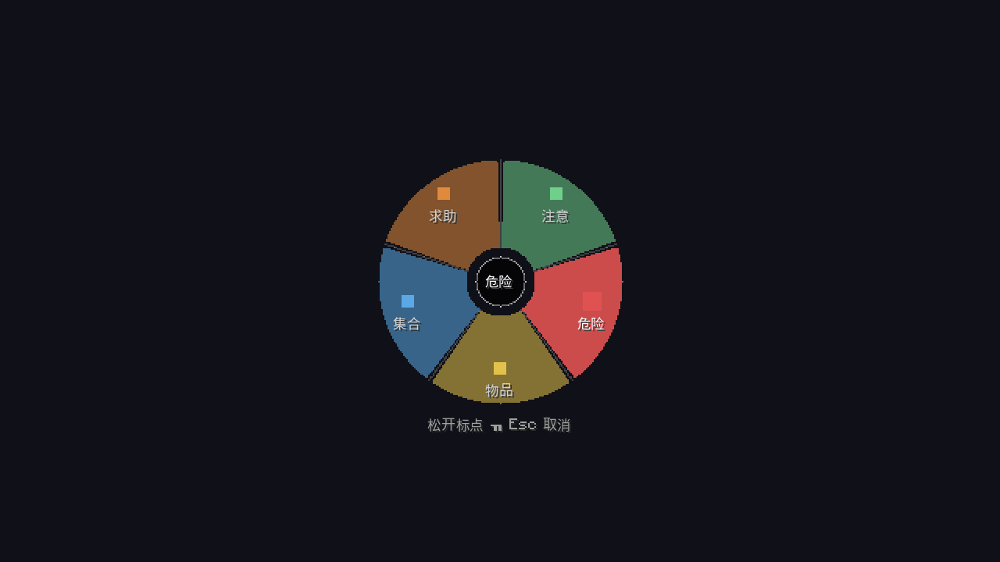
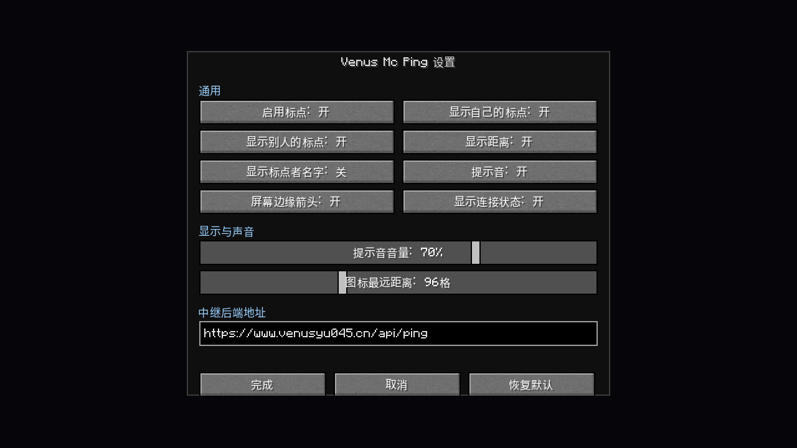

# tools/uipreview —— 无头 UI 预览器（VMPing 版）

把模组的游戏内界面（标点轮盘 / 设置界面）渲染成 PNG，**不需要显卡、不需要启动 Minecraft**。

```bash
bash tools/uipreview/run.sh --all --report     # 所有场景各出一张 + 布局自检
bash tools/uipreview/run.sh --scenario=settings
bash tools/uipreview/serve.sh                  # 起交互服务，浏览器里真的点
```

产物在 `build/uipreview/`：

| 文件 | 内容 |
|---|---|
| `preview-<场景>-zh_cn-640x360.png` | 渲染图 |
| `report-<场景>-zh_cn.txt` | 布局自检报告 |




---

## 原理

Minecraft 26.x 的 GUI 是**提取式渲染**：`Screen#extractRenderState` 拿到的
`GuiGraphicsExtractor` 并不立刻画像素，只把"要画什么"写进渲染状态。这个设计天然适合无头预览
—— 把那个对象换成一个只做记录的替身就行：

```
语言文件 zh_cn.json ──MiniJson──▶ Component.translatable 解析出真实文案
轻量 Minecraft 单例 ──▶ Screen 需要的 font / gui / level / window
        │
        ▼
PingWheelScreen / SettingsScreen #init(w, h)              ← 真实布局计算（一个字都没改）
PingWheelScreen / SettingsScreen #extractRenderState(...)  ← 真实绘制逻辑
        │  产出 DrawCommand（fill / blit / text / outline / scissor）
        ▼
Java2DRenderer                                            ← 预览器唯一自己写的一环：照单画图
        │
        ▼
PNG
```

**关键点：坐标、颜色、裁剪、文字位置全部由生产代码算出来**，预览器不参与任何布局计算，
所以预览图上量到的间距就是游戏里会出现的间距。

## 目录结构

```
tools/uipreview/
├── stubs/    net.minecraft.* 的替身（Screen / GuiGraphicsExtractor / Font / Button / EditBox / AbstractSliderButton …）
├── fake/     本模组里"碰了 MC/Fabric 的业务类"的替身（VMPingClient / ModConfig / PingRelay / KeyBindings）
├── app/      适配器：com.venus.vmping.uipreview.VmpingAdapter（场景表 + 界面选择）
├── harness/  内核：录制器 / Java2D 渲染 / HTTP 服务 / 布局自检（不认识任何项目类）
├── web/      交互页面
├── assets/   从客户端 jar 拷出的原版 GUI 精灵图
└── run.sh / serve.sh
```

`core/**`（`PingData` / `PingStore` / `PingKind` …）是纯逻辑，**直接用生产代码**，不写替身 ——
这样验证的才是真实行为。

## 场景

| 场景 | 界面 | 内容 |
|---|---|---|
| `default` | 轮盘 | 鼠标停在「危险」扇区 |
| `wheel_center` | 轮盘 | 鼠标在中心死区（未选中） |
| `wheel_help` | 轮盘 | 选中「求助」扇区 |
| `settings` | 设置 | 默认状态 |
| `settings_hover` | 设置 | 鼠标悬停在开关上 |

加场景只需要改 `app/com/venus/vmping/uipreview/VmpingAdapter.java` 的 `scenarios()`，内核不用动。

## 已知限制

- 只预览 `Screen`（轮盘 / 设置）。**HUD 标点渲染不在覆盖范围内** —— 它走
  `HudElementRegistry` + 相机矩阵投影，需要真客户端的矩阵数据，这里没有。
- 字体用系统回退字体（Noto Sans CJK），与原版像素字体有差异，但**字宽算法与游戏一致**，
  所以布局判定是准的。
- `stubs/` 是按 MC 26.x 的 API 写的；换大版本要重写（约 2500 行，照着 `javap` 抄）。

移植说明见 [`PORTING.md`](PORTING.md)。
